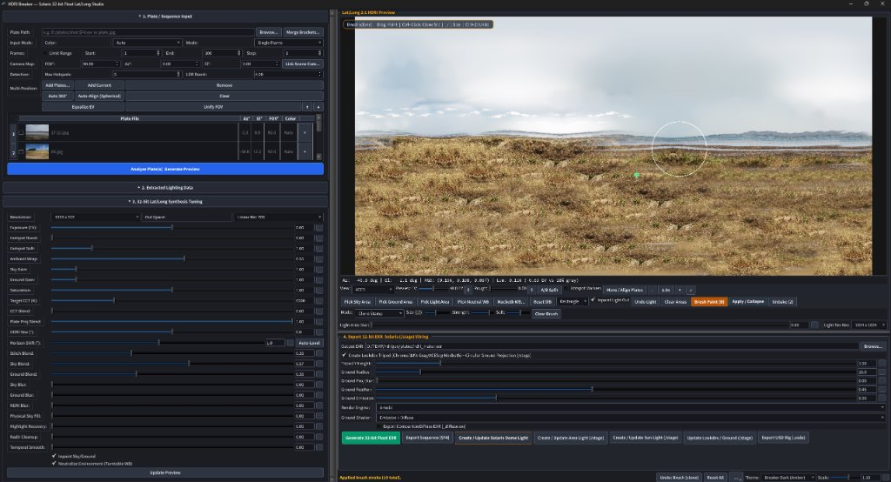
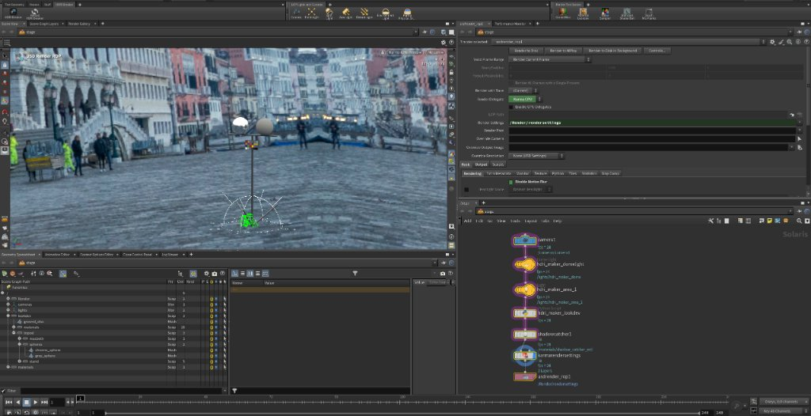
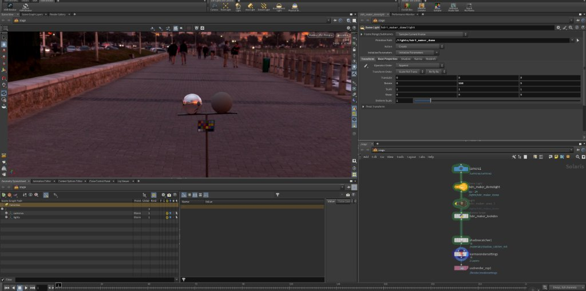
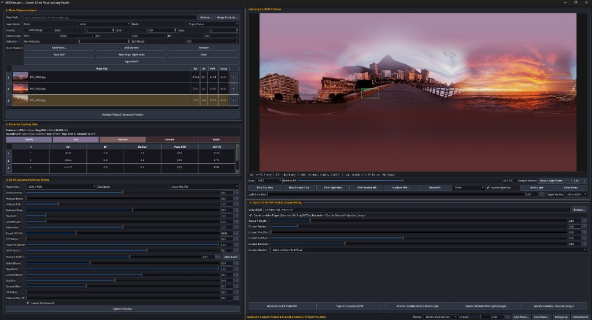

<p align="center">
  
</p>

<h1 align="center">HDRI Breaker — Solaris 32-bit Float Lat/Long Studio</h1>

**HDRI Breaker** is a Houdini 20.0 / 20.5 / 21.0+ Solaris (`/stage`) Lookdev & Lighting studio that extracts physical lighting metrics from single plates, multi-view camera angles, exposure brackets, or image sequences and synthesizes true **32-bit float Lat/Long (2:1) EXR** environment maps, extracted area light textures, and multi-renderer Solaris lookdev rigs (**Karma CPU/XPU**, **Redshift**, **Arnold**, and **Storm / UsdPreviewSurface**).

> 📖 **New here? Read the [Complete Step-by-Step Workflow Tutorial](docs/TUTORIAL.md)** (covering Exposure Brackets, Phone/Camera RAW & DNG, Multi-Position Stitching, 32-bit Brush Cleanup, Apply/Collapse, and Solaris Wiring).

<p align="center">
  
</p>

<p align="center">
  
</p>

<p align="center">
  
</p>

---

## Quick Installation

### Linux (Rocky Linux 9 / AlmaLinux / RHEL / Ubuntu)

Runs out-of-the-box with zero external dependencies (works even if `.sh` executable permissions were stripped by `.zip` downloads or if `~/houdini20.5` / `~/houdini21.0` has not been created yet):

```sh
sh install.sh
```
*(Or via Python / `hython` directly)*:
```sh
python3 scripts/install.py
```

- Automatically detects `$HOUDINI_PACKAGE_DIR`, `$HOUDINI_USER_PREF_DIR`, `~/houdini20.0`, `~/houdini20.5`, `~/houdini21.0`, and `/opt/hfs*`.
- Writes an absolute-path `hdri_maker.json` package file (avoiding the `$HOUDINI_PACKAGE_PATH/..` relative-path trap).
- Uses strict `LF` line endings and pure POSIX `sh` syntax.

To update on Linux:
```sh
sh update.sh
```

To uninstall on Linux:
```sh
sh uninstall.sh
```

### Windows

Double-click **`install_to_houdini.bat`** (or run `python scripts/install.py`).

---

## Opening HDRI Breaker in Houdini

1. Launch **Houdini 20.0, 20.5, or 21.0+** and switch to the **Solaris** (`Build` / `Solaris`) desktop.
2. **Shelf Tool**: Add the **HDRI Breaker** shelf (`+` -> `Shelves` -> `HDRI Breaker`) and click **HDRI Breaker**.
3. **Dockable Python Panel**: Create a **Python Panel** pane and choose **HDRI Breaker (Solaris)** from the dropdown.

---

## Key Features

- **Plate & Multi-View Spherical Stitching**:
  - Single plate, stabilized sequence master, per-frame sequence export, and multi-angle camera plates with cached thumbnails, per-row removal (`x` / `Del`), `Auto 360 deg`, and coarse-to-fine **Auto-Align (Spherical)**.
  - **Merge Brackets...**: Combine multiple LDR/HDR bracketed exposures (`-2 EV`, `0 EV`, `+2 EV`) into a true 32-bit float linear `.exr`.
- **Interactive Preview, False Color & Direct Region Handles**:
  - Switch between **ACES**, **False Color (EV)**, **Reinhard**, and **Linear** preview modes.
  - Hover over the Lat/Long preview for live `(Az deg, El deg, Linear RGB, Luminance, EV vs 18% Gray)` readout.
  - Click and drag directly inside or along the edges of existing `SKY`, `GROUND`, and `LIGHT #` boxes to move or resize them in real time.
  - **Pick Neutral WB**: Drag over any neutral gray or Macbeth patch to auto-calibrate `Target CCT (K)` and exposure.
  - **Auto-Level**: Automatically detect the sky/ground horizon transition and level `Horizon Shift (deg)`.
- **Solaris (`/stage`) Multi-Renderer Lookdev & Ground Projection**:
  - One-click `UsdLuxDomeLight` (`domelight::2.0`), extracted textured `UsdLuxRectLight` / `UsdLuxDiskLight` area lights (`light::2.0` with un-premultiplied RGB + smooth alpha feather), and `/lookdev` Tripod (Chrome ball, 18% Gray ball, 24-patch ACEScg/Rec.709 Macbeth chart) + Circular Ground Disc.
  - Selectable **Ground Shader** modes across **Karma MaterialX**, **Redshift**, **Arnold**, and **UsdPreviewSurface**:
    - `Emissive + Diffuse`
    - `Emissive Only (No Diffuse)`
    - `Diffuse Only (No Emission)`
    - `Shadow Catcher (Matte)`
- **5 High-Contrast UI Themes & Dynamic UI Scale**:
  - Switch between `Breaker Dark (Amber)`, `Solaris Slate (Cyan)`, `High-Contrast Carbon`, `Cobalt Pro`, and `Daylight Studio (Light)` and scale the interface from `0.60x` to `1.40x`.

---

## Quick Start Tutorial

1. **Load your plate(s) or camera photos** in **Section 1**:
   - For a single shot or sequence, set **Plate Path** via **Browse...** (supports `.exr`, `.hdr`, `.jpg`, `.png`, `.tif`, camera `.raw`, and `$F4` sequences).
   - For multiple angles shot on set or with a phone/camera, click **Add Plates...**, then optionally run **Auto 360°**, **Auto-Align (Spherical)**, and **Equalize EV**.
   - Click **Analyze Plate(s) & Generate Preview**.
2. **Inspect & balance color/exposure** in the **Lat/Long 2:1 HDRI Preview**:
   - Optionally click **Pick Neutral WB** and drag over a neutral grey surface (or use **Macbeth WB...**) to lock white balance and exposure.
   - Use **Move / Align Plates** (or **Auto-Level** in Section 3) if the horizon or camera angles need manual fine-tuning.
3. **Choose pure HDRI vs. Dome + Physical Lights**:
   - To output a **pure HDRI** with unwanted bright spots removed, draw a box/circle with **Pick Light Area**, enable **Inpaint Light Out**, and skip creating separate area lights.
   - To extract bright sources (sun, windows, practicals) into **physical Solaris Area Lights**, draw **Pick Light Area** regions with **Inpaint Light Out** checked (removes them from the dome so they aren't double-counted), then click **Create / Update Area Light (/stage)**.
4. **Tune & Export**:
   - Adjust **Exposure (EV)**, **Sky/Ground Gain**, **Blur**, and **Physical Sky Fill** in **Section 3** and click **Update Preview** (auto-updates live as you drag).
   - In **Section 4**, pick your **Output EXR** path, select your **Render Engine** (`Karma (MaterialX)`, `Redshift`, or `Arnold`), and click **Generate 32-Bit Float EXR**, **Create / Update Solaris Dome Light**, and **Update Lookdev / Ground (/stage)**.

---

## Complete UI & Parameter Reference

<p align="center">
  
</p>

### 1. Plate / Sequence Input

| Control | Description |
| :--- | :--- |
| **Plate Path** + **Browse...** | Path to a single frame (`.exr`, `.hdr`, `.jpg`, `.png`, `.tif`, `.raw`) or sequence using `$F4` / `####`. |
| **Merge Brackets...** | Merges multiple bracketed exposures (e.g., `-2 EV`, `0 EV`, `+2 EV`) into a single 32-bit linear `.exr`. |
| **Input Mode: Color** | Input color space (`Auto`, `sRGB`, `Linear Rec.709`, `ACEScg`). |
| **Input Mode: Mode** | `Single Frame`, `Sequence Master (Stabilized)`, or `Per-Frame Sequence`. |
| **Frames (`Limit Range`, `Start`, `End`, `Step`)** | Restricts frame range and sampling step when analyzing image sequences. |
| **Camera Map (`FOV°`, `Az°`, `El°`)** | Horizontal field of view, azimuth, and elevation angle for the active plate projection. |
| **Detection (`Max Hotspots`, `LDR Boost`)** | Maximum number of automatic light hotspots to detect and dynamic-range boost factor for 8-bit/LDR inputs. |
| **Multi-Position Grid** (`Add Plates...`, `Add Current`, `Remove`, `Auto 360°`, `Auto-Align (Spherical)`, `Clear`, `Equalize EV`) | Manage multi-angle plates: distribute angles evenly around 360°, auto-align overlapping spherical seams, clear the list, or normalize exposure differences across shots. |
| **Multi-View Table** | Lists each loaded plate with thumbnail, filename, `Az°`, `El°`, `FOV°`, `Color` space, and quick remove (`×`). |
| **Analyze Plate(s) & Generate Preview** | Runs lighting extraction, spherical projection, and builds the live 2:1 Lat/Long preview. |

---

### 2. Extracted Lighting Data

| Element | Description |
| :--- | :--- |
| **Metrics Bar** | Displays analyzed frame count, dynamic range (**DR** in stops), **Key/Fill** ratio, **EV100**, **Overall CCT**, tint (`Duv`), and **Key / Sky / Ground** temperatures. |
| **Tonal Swatches** (`Zenith`, `Sky`, `Horizon`, `Ground`, `Nadir`) | Visualizes the extracted vertical tonal gradient from zenith down to nadir. |
| **Hotspot Table** (`#`, `Az°`, `El°`, `Radius°`, `Peak HDR`, `CCT (K)`) | Lists automatically detected or user-picked hotspots with spherical coordinates, angular radius, peak linear intensity, and color temperature. |

---

### 3. 32-Bit Lat/Long Synthesis Tuning

| Parameter | Description |
| :--- | :--- |
| **Resolution** / **Out Space** | Output Lat/Long 2:1 resolution (`1024 x 512` up to `8192 x 4096`) and target linear color space (`Linear Rec.709` or `ACEScg`). |
| **Exposure (EV)** | Global exposure offset in stops applied to the synthesized HDRI. |
| **Hotspot Boost** | Scales peak HDR energy of detected hotspots/sun for stronger specular highlights and sharper shadows. |
| **Hotspot Soft** | Softens hotspot falloff/edge rolloff. |
| **Ambient Wrap** | Controls how broadly ambient fill wraps across the mid-elevation hemisphere. |
| **Sky Gain** / **Ground Gain** | Independent luminance multipliers for the upper (sky) and lower (ground) hemispheres. |
| **Saturation** | Global color saturation multiplier. |
| **Target CCT (K)** / **CCT Blend** | Target white-balance color temperature in Kelvin and blend amount (`0` = original, `1` = full target CCT). |
| **Plate Proj Blend** | Blends between pure procedural sky/ground gradient (`0.0`) and full projected plate detail (`1.0`). |
| **HDRI Yaw (°)** | Rotates the synthesized 360° environment horizontally. |
| **Horizon Shift (°)** + **Auto-Level** | Shifts the horizon vertically in degrees; **Auto-Level** automatically detects the horizon line from the plate. |
| **Stitch Blend** | Feather width across seams between multiple projected camera plates. |
| **Sky Blend** / **Ground Blend** | Blend factor for custom picked or synthesized sky and ground regions. |
| **Sky Blur** / **Ground Blur** / **HDRI Blur** | Directional/isotropic smoothing for sky, ground, or the entire HDRI map. |
| **Physical Sky Fill** | Fills uncovered zenith/sky areas using a physically based atmospheric sky gradient matched to the plate. |
| **Inpaint Sky/Ground** | Automatically inpaints missing/unmapped areas at the top and bottom poles cleanly. |
| **Update Preview** | Manually refreshes the 2:1 preview on demand. |

---

### Lat/Long 2:1 HDRI Preview & Interactive Tools (Right Top)

- **Preview Canvas & Inspector**: Displays the live 2:1 equirectangular HDRI. Hovering updates the bottom readout (`Az°`, `El°`, `UV`, `Linear RGB`, `Lum`, and `EV vs 18% Gray`).
- **View / Preview EV / Zoom (`-`, `1.0x`, `+`)**: Switch tone-mapping (`ACES`, `False Color (EV)`, `Reinhard`, `Linear`, `Overlap Diff`), scrub viewport exposure without altering export values, and zoom/pan the preview.
- **Hotspot Markers**: Toggles overlays showing detected hotspots and custom `SKY`, `GROUND`, and `LIGHT #` regions.
- **Move / Align Plates**: Enables interactive dragging on the canvas and opens the **Plate Transform Bar** (`Plate`, `Az°`, `El°`, `Roll°`, `FOV°`, `ScaleX`, `ScaleY`, `Warp`, `EV`, `Vignette`, `Lens` model, `Mask Area`, `Clear Masks`, `Reset`).
- **Pick Sky Area / Pick Ground Area**: Draw a region on the preview to sample/guide sky or ground synthesis.
- **Pick Light Area** (`Rectangle` / `Circle`): Draw a region around a bright light source to extract it as a textured Solaris Area Light (or paint it out).
- **Pick Neutral WB / Macbeth WB... / Reset WB**: Drag across a neutral surface (or match a Macbeth patch) to calibrate white balance and exposure; **Reset WB** restores defaults.
- **Inpaint Light Out / Undo Light / Clear Areas**: When **Inpaint Light Out** is checked, picked light areas are smoothly painted out of the HDRI dome (ideal for avoiding double lighting with Solaris Area Lights, or simply cleaning up unwanted hotspots in a pure HDRI).
- **Light Area Blur / Light Tex Res**: Edge softness and output resolution (`256 x 256` to `2048 x 2048`) for extracted area light textures.

---

### 4. Export 32-Bit EXR & Solaris `/stage` Wiring (Right Bottom)

| Control | Description |
| :--- | :--- |
| **Output EXR** + **Browse...** | Target file path for the exported 32-bit float Lat/Long `.exr`. |
| **Create Lookdev Tripod (...) + Circular Ground Projection (/stage)** | Toggles automatic creation of the `/lookdev` calibration rig (Chrome ball, 18% Gray ball, 24-patch Macbeth chart) and feathered Ground Disc. |
| **Tripod Y Height** | Vertical height of the lookdev spheres and Macbeth chart above the ground plane. |
| **Ground Radius** | Radius of the circular `/lookdev/ground_disc` in scene units. |
| **Ground Proj Blur** | Blur amount applied to the top-down projected ground texture. |
| **Ground Feather** | Controls the smooth radial opacity falloff at the edge of the ground disc. |
| **Ground Emission** | Emissive intensity of the projected ground texture. |
| **Render Engine** | Selects the active renderer (`Karma (MaterialX)`, `Redshift`, or `Arnold`) and automatically creates and binds matching native shaders in `hdri_maker_materials`. |
| **Ground Shader** | Chooses how the ground disc shades: `Emissive + Diffuse`, `Emissive Only (No Diffuse)`, `Diffuse Only (No Emission)`, or `Shadow Catcher (Matte)`. |
| **Generate 32-Bit Float EXR** | Writes the full-resolution 32-bit float `.exr` HDRI to disk. |
| **Export Sequence ($F4)** | Batch-exports per-frame 32-bit `.exr` HDRIs across the configured sequence range. |
| **Create / Update Solaris Dome Light** | Creates or updates `hdri_maker_domelight` (`domelight::2.0`) on `/stage` wired to the generated HDRI. |
| **Create / Update Area Light (/stage)** | Creates or updates textured `light::2.0` area lights on `/stage` for all picked light regions. |
| **Update Lookdev / Ground (/stage)** | Builds or refreshes `/lookdev` geometry and `hdri_maker_materials` for the selected **Render Engine**. |
| **Footer Bar** (`Theme`, `UI Scale`, `Save State...`, `Load State...`, `Debug Log`, `Reload Code`) | Switch UI themes, adjust UI scale, manually export/import session JSON presets (sessions also auto-save inside your `.hip` file), inspect logs, or hot-reload Python modules without restarting Houdini. |
