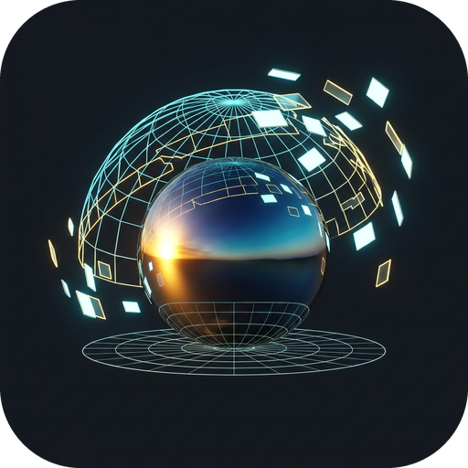

<p align="center">
  
</p>

<h1 align="center">HDRI Breaker — Solaris 32-bit Float Lat/Long Studio</h1>

**HDRI Breaker** is a Houdini 20.0 / 20.5 / 21.0+ Solaris (`/stage`) Lookdev & Lighting studio that extracts physical lighting metrics from single plates, multi-view camera angles, exposure brackets, or image sequences and synthesizes true **32-bit float Lat/Long (2:1) EXR** environment maps, extracted area light textures, and multi-renderer Solaris lookdev rigs (**Karma CPU/XPU**, **Redshift**, **Arnold**, and **Storm / UsdPreviewSurface**).

---

## Quick Installation

### Linux (Rocky Linux 8 / Rocky Linux 9 / AlmaLinux / RHEL / Ubuntu)

Runs out-of-the-box with zero external dependencies (works even if `.sh` executable permissions were stripped by `.zip` downloads or if `~/houdini20.5` / `~/houdini21.0` has not been created yet):

```sh
sh install.sh
```
*(Or via Python / `hython` directly)*:
```sh
python3 scripts/install.py
```

- Automatically detects `$HOUDINI_PACKAGE_DIR`, `$HOUDINI_USER_PREF_DIR`, `~/houdini20.0`, `~/houdini20.5`, `~/houdini21.0`, and `/opt/hfs*`.
- Writes an absolute-path `hdri_maker.json` package file (avoiding the `$HOUDINI_PACKAGE_PATH/..` relative-path trap).
- Uses strict `LF` line endings and pure POSIX `sh` syntax.

To uninstall on Linux:
```sh
sh uninstall.sh
```

### Windows

Double-click **`install_to_houdini.bat`** (or run `python scripts/install.py`).

---

## Opening HDRI Breaker in Houdini

1. Launch **Houdini 20.0, 20.5, or 21.0+** and switch to the **Solaris** (`Build` / `Solaris`) desktop.
2. **Shelf Tool**: Add the **HDRI Breaker** shelf (`+` -> `Shelves` -> `HDRI Breaker`) and click **HDRI Breaker**.
3. **Dockable Python Panel**: Create a **Python Panel** pane and choose **HDRI Breaker (Solaris)** from the dropdown.

---

## Key Features

- **Plate & Multi-View Spherical Stitching**:
  - Single plate, stabilized sequence master, per-frame sequence export, and multi-angle camera plates with cached thumbnails, per-row removal (`x` / `Del`), `Auto 360 deg`, and coarse-to-fine **Auto-Align (Spherical)**.
  - **Merge Brackets...**: Combine multiple LDR/HDR bracketed exposures (`-2 EV`, `0 EV`, `+2 EV`) into a true 32-bit float linear `.exr`.
- **Interactive Preview, False Color & Direct Region Handles**:
  - Switch between **ACES**, **False Color (EV)**, **Reinhard**, and **Linear** preview modes.
  - Hover over the Lat/Long preview for live `(Az deg, El deg, Linear RGB, Luminance, EV vs 18% Gray)` readout.
  - Click and drag directly inside or along the edges of existing `SKY`, `GROUND`, and `LIGHT #` boxes to move or resize them in real time.
  - **Pick Neutral WB**: Drag over any neutral gray or Macbeth patch to auto-calibrate `Target CCT (K)` and exposure.
  - **Auto-Level**: Automatically detect the sky/ground horizon transition and level `Horizon Shift (deg)`.
- **Solaris (`/stage`) Multi-Renderer Lookdev & Ground Projection**:
  - One-click `UsdLuxDomeLight` (`domelight::2.0`), extracted textured `UsdLuxRectLight` / `UsdLuxDiskLight` area lights (`light::2.0` with un-premultiplied RGB + smooth alpha feather), and `/lookdev` Tripod (Chrome ball, 18% Gray ball, 24-patch ACEScg/Rec.709 Macbeth chart) + Circular Ground Disc.
  - Selectable **Ground Shader** modes across **Karma MaterialX**, **Redshift**, **Arnold**, and **UsdPreviewSurface**:
    - `Emissive + Diffuse`
    - `Emissive Only (No Diffuse)`
    - `Diffuse Only (No Emission)`
    - `Shadow Catcher (Matte)`
- **5 High-Contrast UI Themes & Dynamic UI Scale**:
  - Switch between `Breaker Dark (Amber)`, `Solaris Slate (Cyan)`, `High-Contrast Carbon`, `Cobalt Pro`, and `Daylight Studio (Light)` and scale the interface from `0.60x` to `1.40x`.
