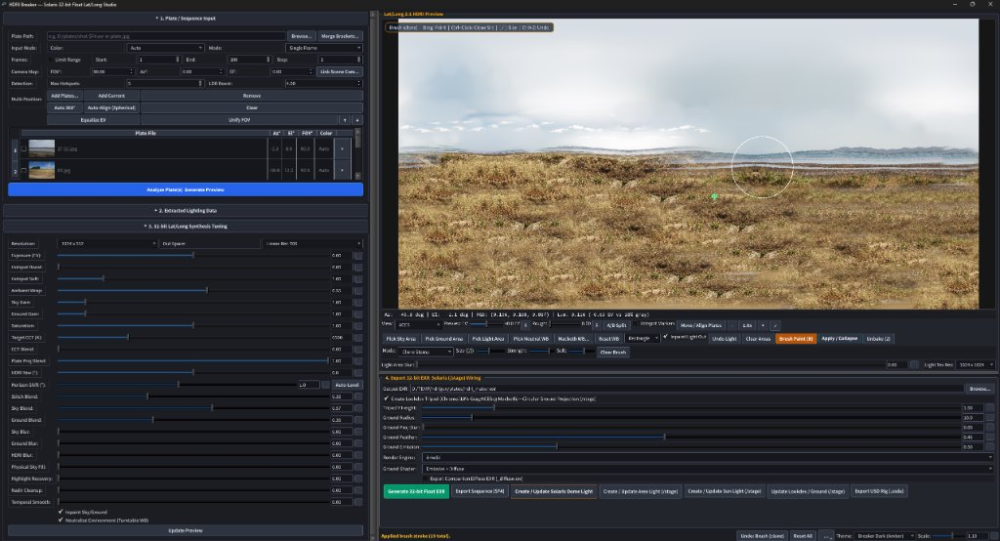

# HDRI Breaker — Interactive Tutorial Hub

Welcome to the **HDRI Breaker** documentation. Click any highlighted section or topic below to open its dedicated, focused guide:

---

## Choose a Tutorial Section

| Section | Focus | Direct Link |
| :--- | :--- | :--- |
| **Brackets & RAW Setup** | Shooting `-2 / 0 / +2 EV` brackets, **Batch Brackets...** (full 360° auto-group & merge), **Merge Brackets...**, Phone/iPhone `.dng` / `.heic` & Camera RAWs | **[Open Brackets & RAW Guide →](tutorials/01_brackets_and_raw.md)** |
| **1. Plate / Sequence Input** | Loading plates, `$F4` sequences, **Auto 360°**, **Auto-Align**, **Equalize EV**, **Unify FOV**, `↑`/`↓`, checkboxes | **[Open Section 1 Guide →](tutorials/02_plate_input_and_alignment.md)** |
| **2. Extracted Lighting Data** | Reading **DR**, **Key/Fill**, **EV100**, **CCT**, **Duv**, Tonal Swatches, and Hotspot Table | **[Open Section 2 Guide →](tutorials/03_lighting_analysis.md)** |
| **3. 32-bit Synthesis Tuning** | **Exposure**, **Hotspot Boost**, **Sky/Ground Gain**, **Target CCT**, **Horizon Shift / Auto-Level**, **Physical Sky Fill** | **[Open Section 3 Guide →](tutorials/04_synthesis_tuning.md)** |
| **Viewport, Brush & Apply/Collapse** | **Move/Align (`E`)** + Right-Click menu, **Pick Sky/Ground/WB**, **Brush Paint (`B`)**, **Apply / Collapse**, **Global Undo (`Ctrl+Z`)** | **[Open Viewport & Brush Guide →](tutorials/05_preview_brush_and_bake.md)** |
| **4. Solaris (`/stage`) Export** | **32-bit Float EXR**, **Area/Sun Lights**, **Lookdev Tripod & Ground Disc** (Karma / Redshift / Arnold), **USD Rig** | **[Open Section 4 Guide →](tutorials/06_solaris_export.md)** |

---

## Quick End-to-End Checklist

1. **[Merge Brackets](tutorials/01_brackets_and_raw.md)** *(if shooting bracketed exposures)* → creates a 32-bit `.exr` per camera angle.
2. **[Load & Align Plates](tutorials/02_plate_input_and_alignment.md)** → **Add Plates...** → **Auto 360°** → **Analyze** → **Auto-Align (Spherical)** → **Equalize EV**.
3. **[Check Lighting Metrics](tutorials/03_lighting_analysis.md)** → verify **DR**, **CCT**, and detected **Hotspots**.
4. **[Clean & Collapse](tutorials/05_preview_brush_and_bake.md)** → **Pick Sky/Ground**, **Pick Neutral WB**, **Brush Paint (`B`)**, then **Apply / Collapse (`Ctrl+Enter`)**.
5. **[Tune Synthesis](tutorials/04_synthesis_tuning.md)** → adjust **Exposure**, **Target CCT**, **Yaw**, and **Auto-Level**.
6. **[Export to Solaris](tutorials/06_solaris_export.md)** → **Generate 32-bit Float EXR** → **Create / Update Solaris Dome Light** & Lookdev Rig.
