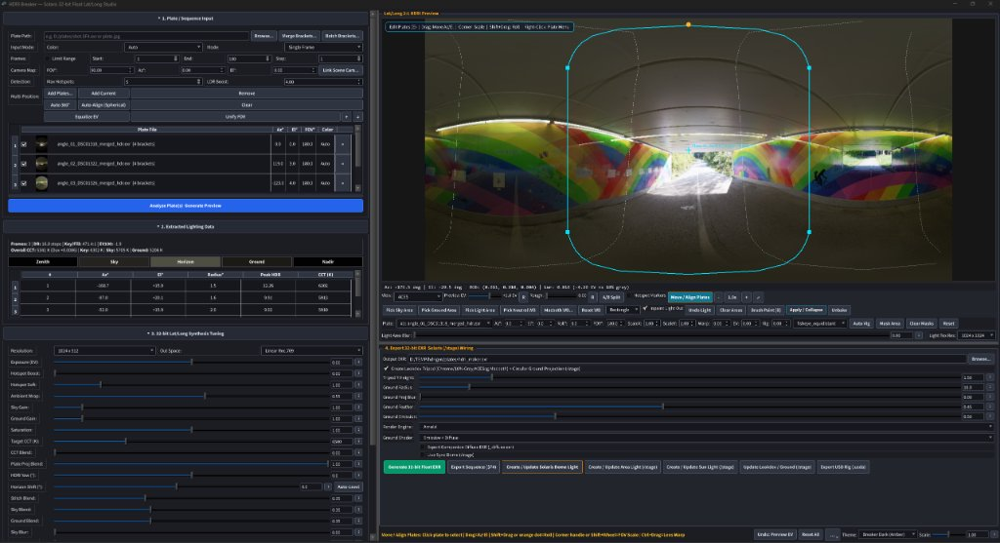

[← Back to Tutorial Hub](../TUTORIAL.md) | [Next: 1. Plate / Sequence Input →](02_plate_input_and_alignment.md)

# Exposure Brackets Setup, Merging & Phone/Camera RAW



Shooting and merging exposure brackets is the best way to capture **true unclamped HDR dynamic range** (sun, sky, and deep shadows) using a standard DSLR, mirrorless camera, or smartphone.

> **Free Practice Sample Dataset**: Want to test right away? Download the 12 sample bracketed fisheye photos in **[`docs/samples/tutorial5/`](../samples/tutorial5/)** (3 camera angles × 4 exposures each, 26.8 EV dynamic range).

---

## 1. Camera / Phone Bracket Shooting Rules

To prevent ghosting, color shifts, and brightness mismatches during merging:

- **Lock Aperture** (e.g., `f/5.6`–`f/8`): Never change aperture between brackets; it alters depth of field and lens vignetting.
- **Lock ISO**: Use base ISO (`ISO 100` or `ISO 50`).
- **Lock White Balance**: Set a fixed Kelvin or `Daylight (5500K)` preset — **never Auto WB**.
- **Lock Focus**: Switch to Manual Focus (`MF`) or lock `AF/AE`.
- **Vary Shutter Speed Only**:
  - **Overcast / Indoor**: 3 brackets at `-2 EV`, `0 EV`, `+2 EV`
  - **Direct Sun / High Contrast**: 5–7 brackets from `-6 EV` to `+2 EV` in `2 EV` steps (ensure the darkest frame keeps the sun disk unclipped and the brightest frame has clean shadow detail).
- **Multi-Angle 360° Panorama**: Shoot the exact same bracket set at each camera angle around the horizon.

---

## 2. Phone / iPhone RAW (`.dng` / ProRAW, `.heic`) & Camera RAW

HDRI Breaker supports:
- **Phone**: `.dng` (Apple ProRAW / Android RAW), `.heic`, `.heif`
- **Camera RAW**: `.cr2`, `.cr3`, `.nef`, `.nrw`, `.arw`, `.raf`, `.orf`, `.rw2`, `.pef`, `.srw`

> **Enabling full 16-bit linear RAW decoding in Houdini (`hython`)**:  
> Houdini's built-in OpenImageIO does not ship with `libraw` or `libheif`. HDRI Breaker automatically checks for `rawpy`, `pillow-heif`, `dcraw`, `magick`, `darktable-cli`, and Windows WIC. For native 16-bit linear sensor decoding inside Houdini, install once via:
> ```sh
> hython -m pip install rawpy pillow-heif
> ```

---

## 3. Merging Brackets (Single Angle vs. Full 360° Batch)

Building a 360° HDRI from bracketed shots works in **2 stages**:
1. **Brackets → 1 Tile per Direction**: Multiple exposures (`-2, 0, +2 EV`) of the same camera view merge into **one 32-bit `.exr` tile**.
2. **All Direction Tiles → 1 360° Environment Map**: All merged tiles stitch around the sphere to build the final **2:1 Lat/Long HDRI**.

### Method A: 1-Click Full 360° Shoot (`Batch Brackets...` — Recommended)
Suppose you shot **3 angles × 4 brackets = 12 photos** (like the included [`tutorial5`](../samples/tutorial5/) sample set):
1. In **1. Plate / Sequence Input**, click **Batch Brackets...**.
2. Select **all 12 photos** (`DSC01318.jpg` – `DSC01329.jpg`) at once.
3. In the **Batch Bracket Grouping & Auto-Setup** dialog:
   - **Brackets per angle**: Enter **`4`** *(or leave **`0`** when your brackets have >3.5 s pauses between angles or alternating EV cycles)*.
   - Keep **`☑ Auto-detect Lens (Fisheye/Rectilinear), 360° Layout, Auto-Align & Equalize EV`** checked *(uncheck if you prefer manual setup)*.
4. HDRI Breaker automatically:
   - Merges each group of 4 exposures into a 32-bit `.exr` (`angle_01... [4 brackets]`, `angle_02... [4 brackets]`, `angle_03... [4 brackets]`).
   - Detects circular fisheye dark corners and sets **`Lens = fisheye_equidistant`**, **`FOV° = 180.0`** (or `rectilinear` + EXIF FOV for standard lenses).
   - Spreads all angles across `360°`, runs **Analyze**, **Auto-Align (Spherical)**, and **Equalize EV**.
   - *(Tip: Hover any `[N brackets]` row or right-click → **Inspect Bracket Group** to verify its source files, or drag the bar below the table to resize the plate list.)*
5. Finish the HDRI:
   - Fine-tune manually if needed with **Move / Align Plates (`E`)** (right-click any plate on the canvas to **Hide**, **Solo**, **Reorder**, or **Delete**).
   - Fill missing zenith/nadir with **Pick Sky Area** / **Pick Ground Area** (or **Nadir Cleanup**) and clean seams with **Brush Paint (`B`)**.
   - Click **Apply / Collapse (`Ctrl+Enter`)** → set final **Resolution** → **Generate 32-bit Float EXR**.

### Method B: Merging Raw Rows Already in the Multi-Position Table
1. Hold `Ctrl`/`Shift` and select the rows belonging to **Angle 1** (e.g., 3 exposures of the same view).
2. **Right-Click → `Merge Selected Rows as Brackets (3)`** — they collapse into a single `[3 brackets]` `.exr` row in place.
3. Repeat for **Angle 2, Angle 3, ...** until each row represents one direction, then click **Auto 360°** → **Analyze Plate(s) & Generate Preview**.

### Method C: Single Angle Only (`Merge Brackets...`)
1. In **1. Plate / Sequence Input**, click **Merge Brackets...**.
2. Select the **2+ bracketed files for ONE camera angle**.
3. HDRI Breaker merges them using EXIF `EV100` (or luminance-ratio) irradiance weighting into a single unclamped **32-bit float Linear Rec.709 `.exr`** saved next to your source files and places it in **Plate Path**.
4. Keep **Input Mode → Color** on `Auto` and click **Analyze Plate(s) & Generate Preview**.

---

[← Back to Tutorial Hub](../TUTORIAL.md) | [Next: 1. Plate / Sequence Input →](02_plate_input_and_alignment.md)
