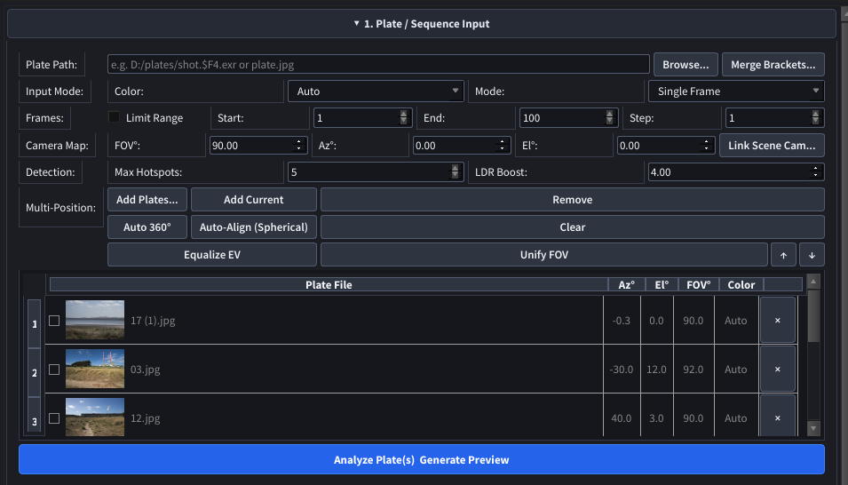

[← Brackets & RAW](01_brackets_and_raw.md) | [Tutorial Hub](../TUTORIAL.md) | [Next: 2. Extracted Lighting Data →](03_lighting_analysis.md)

# 1. Plate / Sequence Input & Multi-Position Alignment

---

## Loading Your Plates

- **Single Frame / Sequence**: Click **Browse...** next to **Plate Path** (supports `.exr`, `.hdr`, `.jpg`, `.png`, `.tif`, `.dng`, `.heic`, camera RAWs, and `$F4` / `####` sequences), or **drag and drop** files directly onto the preview viewport.
- **Multi-Angle 360° Set**: Click **Add Plates...** (or drop multiple files onto the viewport).
- **Input Mode**:
  - **Color**: Keep `Auto` for automatic sRGB→Linear conversion on LDR plates while keeping EXR/RAW linear.
  - **Mode**: `Single Frame`, `Sequence Master (Stabilized)`, or `Per-Frame Sequence`.
- **Frames (`Limit Range`, `Start`, `End`, `Step`)**: Restricts the frame range when processing sequences.

---

## Camera Map & Detection

- **Camera Map (`FOV°`, `Az°`, `El°`)**: Default horizontal field of view and orientation for single-plate projection, or click **Link Scene Cam...** to pull FOV/Az/El from a `/stage` USD Camera or `/obj` Camera.
- **Detection (`Max Hotspots`, `LDR Boost`)**: Controls how many bright hotspots are extracted automatically and how much HDR boost is applied to 8-bit LDR shots.

---

## Multi-Position Controls & Table

| Button / Control | What It Does |
| :--- | :--- |
| **Add Plates...** / **Add Current** | Adds multiple files or the current **Plate Path** to the Multi-View Table. |
| **Auto 360°** | Evenly distributes `Az°` across 360° for all listed plates (ideal first step after loading a 360° ring). |
| **Auto-Align (Spherical)** | Refines overlapping `Az°` and `El°` automatically using coarse-to-fine spherical correlation. |
| **Equalize EV** | Matches exposure across overlapping plates to eliminate brightness seams. |
| **Unify FOV** | Copies the selected (or first) plate's `FOV°` to all plates and resets Scale X/Y to `1.0`. |
| **`↑` / `↓`** | Moves the selected plate row up/down in blend order. |
| **Row Checkbox** | Temporarily hides/disables a plate from synthesis without deleting it. |
| **Double-Click `Az°` / `El°` / `FOV°`** | Manually type exact camera angles or field of view per plate. |

Click the blue **Analyze Plate(s) & Generate Preview** button to build the 2:1 Lat/Long canvas and populate **[Section 2: Extracted Lighting Data](03_lighting_analysis.md)**.

---

[← Brackets & RAW](01_brackets_and_raw.md) | [Tutorial Hub](../TUTORIAL.md) | [Next: 2. Extracted Lighting Data →](03_lighting_analysis.md)
