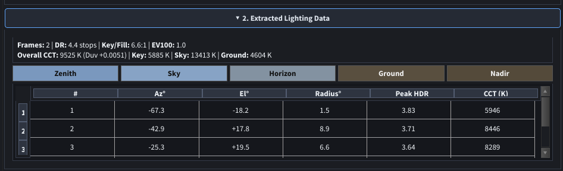

[← 1. Plate Input](02_plate_input_and_alignment.md) | [Tutorial Hub](../TUTORIAL.md) | [Next: 3. Synthesis Tuning →](04_synthesis_tuning.md)

# 2. Extracted Lighting Data

*(Click the **`▾ 2. Extracted Lighting Data`** header anytime to collapse or expand this section.)*

---

## What Each Readout Means

- **Metrics Bar**:
  - **Frames**: Number of active frames/plates analyzed.
  - **DR (stops)**: Measured dynamic range in EV stops between shadows and peak highlights.
  - **Key/Fill**: Lighting contrast ratio between the dominant key direction and ambient fill.
  - **EV100**: Estimated scene exposure value at ISO 100.
  - **Overall CCT / Duv / Key / Sky / Ground**: Correlated Color Temperature (Kelvin) and green-magenta tint (`Duv`) for the overall scene, key hotspot, upper sky, and lower ground.
- **Tonal Swatches** (`Zenith`, `Sky`, `Horizon`, `Ground`, `Nadir`):
  - Visualizes the vertical color & luminance gradient extracted from the environment.
- **Hotspot Table** (`#`, `Az°`, `El°`, `Radius°`, `Peak HDR`, `CCT (K)`):
  - Lists the brightest automatically detected light sources with their spherical coordinates, angular size, peak linear intensity, and color temperature.

---

[← 1. Plate Input](02_plate_input_and_alignment.md) | [Tutorial Hub](../TUTORIAL.md) | [Next: 3. Synthesis Tuning →](04_synthesis_tuning.md)
