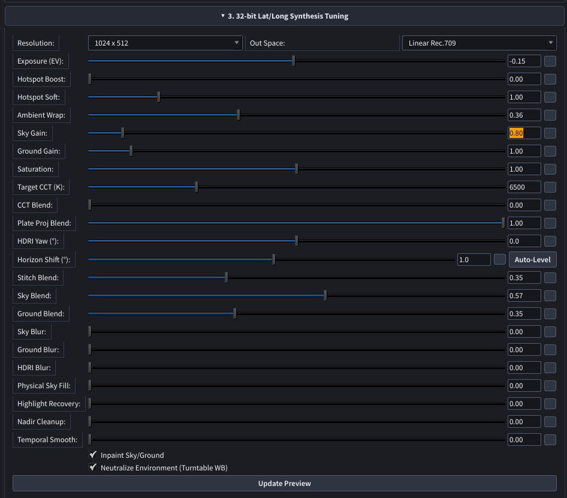

[← 2. Lighting Data](03_lighting_analysis.md) | [Tutorial Hub](../TUTORIAL.md) | [Next: Viewport, Brush & Apply/Collapse →](05_preview_brush_and_bake.md)

# 3. 32-bit Lat/Long Synthesis Tuning

Every slider update runs live with debounced fast previewing and supports **Global Undo (`Ctrl+Z`)** + individual **`R`** reset buttons.

---

## Parameter Reference

| Parameter | Purpose |
| :--- | :--- |
| **Resolution / Out Space** | Output 2:1 Lat/Long resolution (`1024 x 512` up to `8192 x 4096`) and linear color space (`Linear Rec.709` or `ACEScg`). |
| **Exposure (EV)** | Global exposure offset in stops. |
| **Hotspot Boost / Soft** | Boosts peak HDR energy of detected hotspots/sun and softens their rolloff. |
| **Ambient Wrap** | Controls how broadly ambient fill wraps across the mid-elevation band. |
| **Sky Gain / Ground Gain** | Independent brightness multipliers for upper (sky) and lower (ground) hemispheres. |
| **Saturation** | Global color saturation multiplier. |
| **Target CCT (K) / CCT Blend** | Shifts overall color temperature toward a target Kelvin value (`0.0` = original, `1.0` = full target). |
| **Plate Proj Blend** | Blends between procedural sky/ground gradient (`0.0`) and projected camera plates (`1.0`). |
| **HDRI Yaw (°)** | Rotates the 360° environment horizontally. |
| **Horizon Shift (°) + Auto-Level** | Shifts the horizon vertically; **Auto-Level** automatically detects and levels the horizon line. |
| **Stitch Blend** | Feather width across overlapping multi-position plate seams. |
| **Sky Blend / Ground Blend** | Blend strength for picked/synthesized sky and ground regions. |
| **Sky Blur / Ground Blur / HDRI Blur** | Smooths sky, ground, or the entire HDRI (useful for diffuse-friendly maps). |
| **Physical Sky Fill** | Fills uncovered zenith areas with a physically based atmospheric gradient matched to the plate. |
| **Highlight Recovery** | Soft-compresses harsh clipped highlights. |
| **Nadir Cleanup** | Smoothly fills/cleans the bottom tripod pole. |
| **Temporal Smooth** | Temporal stabilization strength across `$F4` image sequences. |
| **Inpaint Sky/Ground** | Automatically inpaints unmapped top/bottom regions. |
| **Neutralize Environment (Turntable WB)** | Neutralizes overall cast for neutral lookdev turntables. |

---

[← 2. Lighting Data](03_lighting_analysis.md) | [Tutorial Hub](../TUTORIAL.md) | [Next: Viewport, Brush & Apply/Collapse →](05_preview_brush_and_bake.md)
