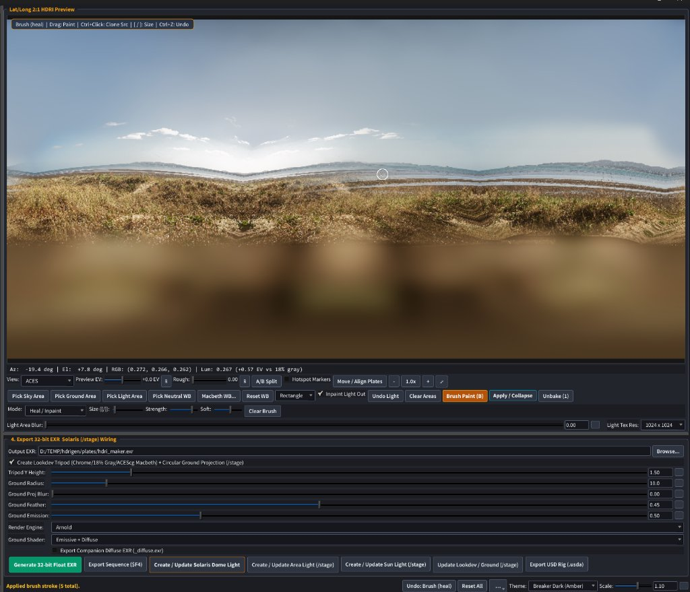

[← 3. Synthesis Tuning](04_synthesis_tuning.md) | [Tutorial Hub](../TUTORIAL.md) | [Next: 4. Solaris Export →](06_solaris_export.md)

# Viewport, Region Pickers, 32-bit Brush & Apply / Collapse

---

## Viewport & Resizing
- **View / Preview EV / Rough**: Switch between `ACES`, `False Color (EV)`, `Reinhard`, `Linear`, and `Overlap Diff`; inspect exposure or glossy-to-diffuse roughness without altering export values.
- **Zoom & Pan**: Mouse wheel zooms, Middle/Right-drag pans when zoomed, `F` or `H` fits to view.
- **Resize / Expand (`⤢`)**: Drag the horizontal/vertical splitters freely, or click **`⤢`** to expand the viewport full-width/height.

---

## Interactive Alignment (`Move / Align Plates (E)`)
- **Left-Drag**: Move `Az° / El°`
- **Corner Handles** (`Shift + Wheel`): Scale `FOV°`
- **`Shift + Drag`** (or orange top dot): Roll°
- **`Ctrl + Drag`**: Lens Warp (`k1`)
- **Right-Click on a Plate**: Opens the quick plate menu (**Hide**, **Solo**, **Show All**, **Move Up/Down**, **Auto-Estimate Vignette**, **Clear Masks**, **Reset Transform**, **Delete**).

---

## Region Pickers & White Balance
- **Pick Sky Area / Pick Ground Area**: Drag a box over clean sky/ground to synthesize missing zenith/nadir areas. Drag existing boxes/edges to move or resize them live.
- **Pick Neutral WB / Macbeth WB... / Reset WB**: Sample any neutral gray surface to calibrate 3-channel WB gains and exposure.
- **Pick Light Area** (`Rectangle` / `Circle`): Select bright light sources to extract as Solaris Area Lights (check **Inpaint Light Out** to remove them from the dome).

---

## 32-bit Float Brush (`B`) & Apply / Collapse (`Ctrl+Enter`)
- Toggle **Brush Paint (`B`)** to open the contextual brush bar:
  - **Heal / Inpaint**, **Clone Stamp** (`Ctrl+Click` to set source), **Blur / Smooth**, **Burn (Dim HDR)**, **Dodge (Boost HDR)**, **Desaturate**.
  - `[` / `]` (or `Ctrl+Left-Drag`) adjusts Size; `Ctrl+Right-Drag` adjusts Strength; `Shift+Left-Drag` adjusts Softness.
  - **`Ctrl+Z`** undoes **one stroke at a time** without wiping earlier strokes or edits.
- **Apply / Collapse (`Ctrl+Enter`)**:
  - Collapses plate stitching, sky/ground/light inpainting, and brush strokes into a fast 32-bit canvas so sliders are instant.
  - Saves up to 5 checkpoints for **Unbake (`N`)**. `Ctrl+Z` after baking only undoes post-bake edits and never accidentally unbakes your collapsed canvas.

---

[← 3. Synthesis Tuning](04_synthesis_tuning.md) | [Tutorial Hub](../TUTORIAL.md) | [Next: 4. Solaris Export →](06_solaris_export.md)
