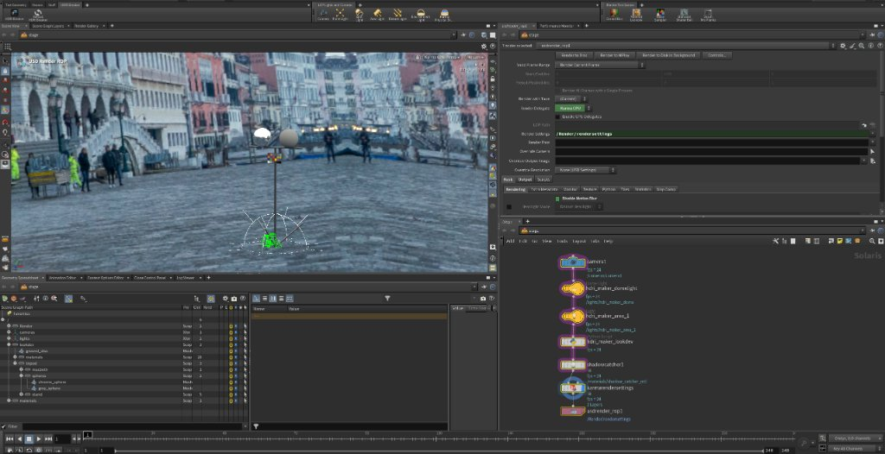

[← Viewport & Brush](05_preview_brush_and_bake.md) | [Tutorial Hub](../TUTORIAL.md)

# 4. Exporting 32-bit EXR & Solaris (`/stage`) Wiring

---

## Output & Lookdev Settings

- **Output EXR**: Target path for the synthesized 32-bit float Lat/Long `.exr` (e.g. `$HIP/tex/hdri_maker.exr`).
- **Create Lookdev Tripod + Circular Ground Projection (`/stage`)**:
  - Builds `/lookdev` with a Chrome ball, 18% Gray ball, 24-patch ACEScg/Rec.709 Macbeth chart, and a feathered circular Ground Disc.
  - **Tripod Y Height**, **Ground Radius**, **Ground Proj Blur**, **Ground Feather**, **Ground Emission**: Fine-tune ground projection placement and blending.
- **Render Engine**: Select **Karma (MaterialX)**, **Redshift**, or **Arnold** to generate matching native shaders under `/stage/hdri_maker_materials`.
- **Ground Shader**: `Emissive + Diffuse`, `Emissive Only (No Diffuse)`, `Diffuse Only (No Emission)`, or `Shadow Catcher (Matte)`.
- **Export Companion Diffuse EXR (`_diffuse.exr`)**: Writes a firefly-free irradiance EXR alongside the full-range specular EXR.

---

## Export & Solaris Actions

| Button | Action |
| :--- | :--- |
| **Generate 32-bit Float EXR** | Writes the full-resolution 32-bit float Lat/Long `.exr` to disk. |
| **Export Sequence ($F4)** | Batch-exports per-frame 32-bit `.exr` files across an analyzed sequence. |
| **Create / Update Solaris Dome Light** | Creates or updates `/stage/hdri_maker_domelight` (`domelight::2.0`) wired to your EXR. |
| **Create / Update Area Light (/stage)** | Creates textured `light::2.0` area lights for every **Pick Light Area** region. |
| **Create / Update Sun Light (/stage)** | Extracts Hotspot #1 as a Solaris Distant Light (Sun) aimed at the origin. |
| **Update Lookdev / Ground (/stage)** | Updates `/lookdev` tripod height, ground disc radius/feather/emission, and shader bindings. |
| **Export USD Rig (.usda)** | Exports the active `/stage` dome, lights, and lookdev rig to a standalone `.usda` sublayer. |

---

[← Viewport & Brush](05_preview_brush_and_bake.md) | [Tutorial Hub](../TUTORIAL.md)
